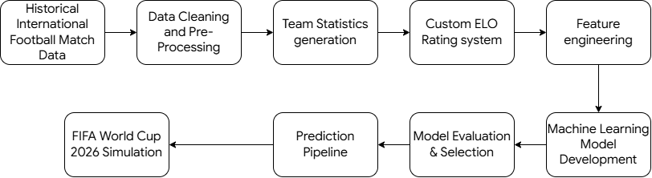
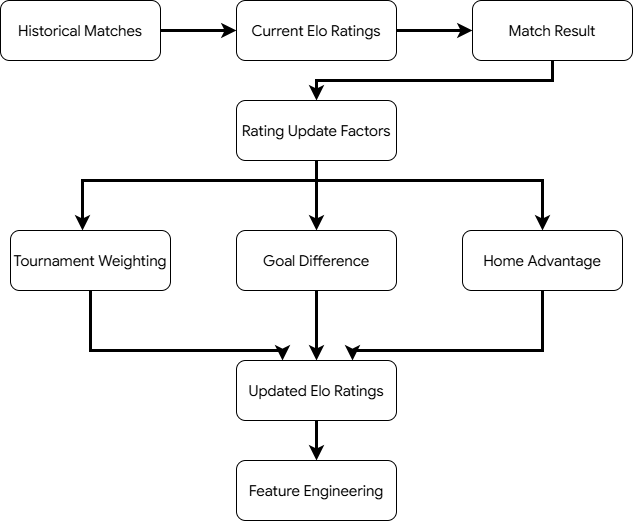
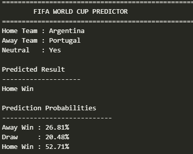

# FIFA World Cup 2026 Predictor


## Overview

I built this project to explore whether the outcome of international football matches can be predicted using historical data and machine learning.

I started with the raw international match data, then developed an end-to-end prediction pipeline that performs data preprocessing, calculates custom Elo ratings, engineers match-level features, trains multiple machine learning models, and predicts match outcomes. The final pipeline can also simulate an entire FIFA World Cup tournament using the trained model.

throughout the project, I experimented with multiple versions of the Elo rating system throughout the project, with several feature engineering approaches and different machine learning algorithms before selecting a tuned LightGBM model as the final predictor.

This repository contains the complete development workflow from raw datasets and exploratory notebooks to the trained model, prediction pipeline, technical report, and World Cup simulator.


## Key Features

- Built an end-to-end machine learning pipeline for predicting international football match outcomes.
- Developed a custom Elo rating system that evolved through four different versions, combining tournament importance, goal difference, and home advantage.
- Created multiple match-level features based on historical team performance and Elo ratings.
- Experimented with various machine learning models like Logistic Regression, Random Forest, XGBoost, CatBoost, and LightGBM.
- Performed hyperparameter tuning to optimize model performance before selecting the final LightGBM model.
- Created a complete prediction pipeline capable of generating predictions for any international football match.
- Implemented a FIFA World Cup tournament simulator using the trained prediction model.
- Included a detailed technical report documenting the methodology, experiments, and design decisions.


## Project Workflow

I designed the project as a complete machine learning pipeline, starting from raw data of international football matches, data preprocessing, feature engineering, model training, and tournament simulation. Each stage builds upon the previous one, resulting in a reproducible workflow from raw data to final predictions.

<p align="center">
  
</p>


## Dataset

I used the **International Football Results (1872–2025)** dataset from Kaggle as the primary data source for this project. The dataset contains official international football matches played between national teams across friendlies, FIFA World Cup qualifiers, continental competitions, and major international tournaments.

Since the goal was to predict modern international football matches, I filtered the dataset to include only matches played from **2000 onwards** and kept only FIFA-recognized national teams. This produced a cleaner and more consistent dataset that reflects the current era of international football.

I generated multiple intermediate datasets for data cleaning, Elo rating calculation, feature engineering and model training. These datasets are included in this repository to make the complete workflow reproducible.

**Dataset Source:** [International Football Results Dataset (Kaggle)](https://www.kaggle.com/datasets/martj42/international-football-results-from-1872-to-2017)


## Custom Elo Rating System

Rather than relying on available team ratings, I built a custom Elo rating system that updates dynamically after every international match.

The system evolved through multiple versions, gradually adding tournament importance, goal difference, and home advantage to produce more representative team ratings. These ratings became one of the most influential features used by the machine learning models.

<p align="center">
  
</p>


## Feature Engineering

To improve the predictive power of the models, I engineered features that capture both long-term team strength and recent form. These include custom Elo ratings, Elo difference, recent win percentage, points per game, average goals scored and conceded, and other comparative features such as Elo difference, win percentage gap, points-per-game gap, and recent scoring trends derived from the last five matches. The complete feature set was then used to train and evaluate the machine learning models.


## Machine Learning Models

I evaluated multiple machine learning algorithms to compare their performance on the engineered feature set. After experimenting with different models and tuning their hyperparameters, I selected **LightGBM** as the final model based on its overall predictive performance and generalization.

| Model | Purpose |
|-------|---------|
| Logistic Regression | Baseline linear model |
| Random Forest | Ensemble tree-based model |
| XGBoost | Gradient boosting benchmark |
| CatBoost | Gradient boosting with ordered boosting |
| **LightGBM** | Final selected model |


## Results

After evaluating multiple machine learning models, **LightGBM** was selected as the final model due to its overall performance on the test dataset. While predicting draws remained challenging—a common characteristic of football prediction tasks—the final pipeline produced consistent results and was integrated into the World Cup simulation system.

| Model | Status |
|--------|--------|
| Logistic Regression | Evaluated |
| Random Forest | Evaluated |
| XGBoost | Evaluated |
| CatBoost | Evaluated |
| **LightGBM** | ✅ Final Model |


| Final Model | Test Accuracy | Prediction Classes |
|-------------|--------------:|-------------------|
| **LightGBM (Tuned)** | **60.25%** | Home Win • Draw • Away Win |

Although the final model achieved the best overall performance, predicting draws remained the most challenging class due to their relatively low frequency and inherent unpredictability in international football.


## Example Prediction

The final prediction pipeline generates class probabilities for any international match and returns the most likely outcome.

<p align="center">
  
</p>


## Repository Structure

The repository is organized to mirror the development workflow, making it easy to follow the project from raw data to the final prediction pipeline.

```text
FIFA-World-Cup-2026-Predictor/
│
├── assets/                 # Images used in the README
├── data/
│   ├── raw/
│   ├── cleaned/
│   ├── processed/
│   ├── features/
│   └── reference/
│
├── model/                  # Final trained LightGBM model
├── notebooks/              # Complete development workflow
├── reports/                # Technical report
│
├── .gitignore
├── LICENSE
├── README.md
└── requirements.txt
```


## Installation

Clone the repository and install the required Python packages:

```bash
git clone https://github.com/AbbuHaque7/FIFA-World-Cup-2026-Predictor.git

cd FIFA-World-Cup-2026-Predictor

pip install -r requirements.txt
```


## Usage

The notebooks are organized chronologically and reflect the complete development process. To reproduce the project, run the notebooks in order, starting with data preprocessing and ending with the prediction pipeline and World Cup simulation.

The trained LightGBM model and supporting files are available in the `model/` directory for inference without retraining.


## Technical Report

A detailed technical report is included in the `reports/` directory, covering the complete development process, including data preprocessing, Elo rating system design, feature engineering, model evaluation, and the final prediction pipeline.

The report documents the reasoning behind each design decision and provides a comprehensive overview of the project from start to finish.


## Future Improvements

Although the current pipeline produces reliable match predictions, there are several opportunities for future improvements:

- Incorporate player-level and squad information.
- Include recent FIFA rankings and team form updates.
- Explore advanced ensemble and deep learning approaches.
- Deploy the prediction pipeline as an interactive web application.

## Historical Dataset Update — November 2026

### Why Was the Dataset Updated?

International football results continue to change, and newer matches provide additional information about teams' recent performance.

To keep the project's historical data up to date ahead of the 2026 FIFA World Cup, I added 520 international matches played between 9 July and 17 November 2026.

**This will be an ongoing update:** I intend to maintain the updated CSV as the project's latest historical dataset by adding newly played international fixtures in future updates, rather than creating a separate CSV for every update.

The original dataset has been preserved to maintain reproducibility and allow comparisons between models trained on different versions of the historical data.

### Dataset Comparison

| Dataset | Matches | Latest Match |
|---|---:|---|
| Original | 23,760 | 7 July 2026 |
| Updated | 24,280 | 17 November 2026 |

The updated dataset retains the existing scope of 210 teams. Team names were standardized, and duplicate records and missing values were checked.

### Retraining the Model

The updated dataset follows the same structure as the original, so the existing workflow can be reused.

To train a new model:
1. Replace the original CSV path with `results_2000_fifa211_18-11-2026.csv` in the relevant notebooks.
2. Run the notebooks in the existing workflow order to regenerate team statistics, Elo ratings, and engineered features.
3. Run the model training and evaluation notebooks.
4. Save the newly trained model and its corresponding feature columns.

**Note:** Existing Elo ratings, engineered features, trained models, and evaluation results have not been regenerated. They remain based on the original dataset. The updated CSV is provided for further experimentation and model retraining.

## License

This project is licensed under the MIT License. See the `LICENSE` file for more information.


